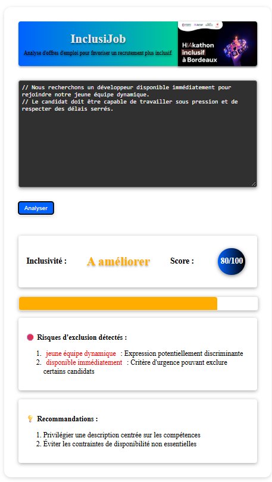

# 🚀 InclusiJob



## Présentation

InclusiJob est un prototype développé dans le cadre du **HIAckathon Inclusif Bordeaux**.

L'application aide les recruteurs à identifier certaines formulations potentiellement excluantes dans leurs offres d'emploi afin de favoriser un recrutement plus inclusif.

L'objectif n'est pas de juger une offre, mais d'attirer l'attention sur certains critères pouvant réduire la diversité des candidatures ou constituer un frein pour certains profils.

---

## Fonctionnalités

### Analyse d'une offre d'emploi

L'utilisateur colle une offre d'emploi dans l'application.

Le système analyse automatiquement le contenu et détecte différents critères potentiellement problématiques :

- Jeune équipe dynamique
- Disponible immédiatement
- Langue maternelle française
- Français sans accent
- Résistance au stress
- Délais serrés
- Et d'autres critères configurables

---

### Score d'inclusivité

Un score sur 100 est calculé afin d'évaluer le niveau global d'inclusivité de l'offre.

Exemples :

- 🟢 90 à 100 : Excellent
- 🟡 70 à 89 : À améliorer
- 🔴 Moins de 70 : Peu inclusif

---

### Identification des risques

Pour chaque critère détecté, l'application affiche :

- le terme identifié ;
- le risque potentiel associé ;
- son impact sur le score.

---

### Recommandations

InclusiJob propose également des recommandations permettant d'améliorer la rédaction de l'offre.

Exemple :

**Critère détecté**

Langue maternelle française

**Suggestion**

Préciser le niveau de français réellement nécessaire pour le poste.

---

## Architecture technique

### Frontend

- HTML5
- CSS3
- JavaScript

### Backend

- Python
- FastAPI

### Communication

- API REST
- JSON
- Fetch API

---

## Fonctionnement

```text
Offre d'emploi
       │
       ▼
Frontend HTML / JavaScript
       │
       ▼
Requête Fetch
       │
       ▼
API FastAPI
       │
       ▼
Moteur d'analyse
       │
       ▼
Score + Risques + Suggestions
       │
       ▼
Interface utilisateur
```

---

## Limites actuelles

La version actuelle repose sur un système de règles métier définies dans le code Python.

L'analyse est réalisée à partir de critères prédéfinis et ne repose pas encore sur un modèle d'intelligence artificielle générative.

---

## Évolutions envisagées

- Intégration d'un LLM (GPT, Mistral, Llama...)
- Analyse contextuelle plus avancée
- Reformulation automatique des offres
- Export PDF des résultats
- Tableau de bord RH
- Historique des analyses
- Statistiques d'inclusivité

---

## Objectif

Favoriser la création d'offres d'emploi plus accessibles, plus inclusives et plus compréhensibles pour tous les candidats.

---

## Auteur

Tony Payet

Projet réalisé dans le cadre du HIAckathon Inclusif Bordeaux.
